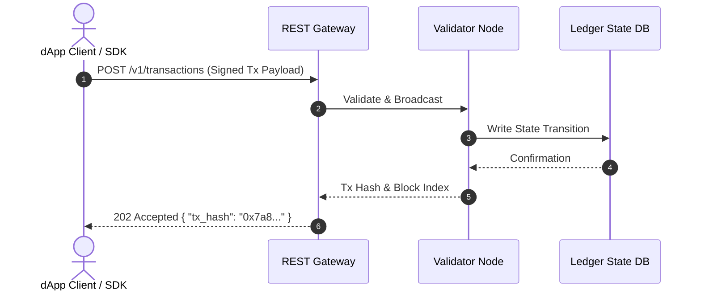

# ChainForge Docs-as-Code & Python SDK Framework

Welcome to the **ChainForge Developer Platform** repository. This project demonstrates a fully automated, synchronized **Docs-as-Code** pipeline built with **MkDocs Material** and **`mkdocstrings`**, tightly integrated with an installable Python SDK (`chainforge-sdk`).

---

## 📁 Repository Directory Structure

```text
chainforge-docs/
├── chainforge_sdk/           # Core SDK Package Directory
│   ├── __init__.py           # Package exports & public API initialization
│   └── client.py             # Main SDK client implementation & docstrings
├── docs/                     # Documentation Source Files (Markdown)
│   ├── index.md              # Portal Landing Page
│   ├── architecture.md       # Platform Architecture & Mermaid Diagrams
│   ├── api-reference.md      # Dynamic mkdocstrings API Injection Page
│   └── sdk-quickstart.md     # SDK Installation & Quickstart Guide
├── check_balance.py          # Standalone balance verification script
├── test_sdk.py               # SDK integration test script
├── pyproject.toml            # Modern Python packaging configuration (PEP 621)
├── mkdocs.yml                # MkDocs portal configuration & navigation
└── .gitignore                # Git environment exclusions
```

---

## 🛠️ Project Source Artifacts

### 1. Packaging Configuration (`pyproject.toml`)
```toml
[build-system]
requires = ["setuptools>=61.0.0"]
build-backend = "setuptools.build_meta"

[project]
name = "chainforge-sdk"
version = "1.0.0"
description = "Official sample Python SDK for ChainForge Developer Platform"
readme = "README.md"
requires-python = ">=3.9"
dependencies = [
    "requests>=2.25.0",
]
```

### 2. Documentation Configuration (`mkdocs.yml`)
```yaml
site_name: ChainForge Developer Portal
site_description: Documentation for ChainForge Smart Contract Blockchain
site_author: Technical Writing Team

theme:
  name: material
  palette:
    primary: indigo
    accent: light blue
  features:
    - navigation.tabs
    - content.code.copy

plugins:
  - search
  - mkdocstrings:
      handlers:
        python:
          paths: [.]

markdown_extensions:
  - pymdownx.superfences:
      custom_fences:
        - name: mermaid
          class: mermaid
          format: !!python/name:pymdownx.superfences.def_list_handler

nav:
  - Home: index.md
  - Architecture: architecture.md
  - API Reference: api-reference.md
  - SDK Quickstart: sdk-quickstart.md
```

### 3. Git Exclusions (`.gitignore`)
```text
venv/
site/
__pycache__/
*.pyc
.DS_Store
.benchmarks/
```

---

## 🐍 Python SDK Source Files

### Package Exports (`chainforge_sdk/__init__.py`)
```python
from .client import ChainForge, DotDict

__all__ = ["ChainForge", "DotDict"]
```

### Core Implementation (`chainforge_sdk/client.py`)
```python
import os
import json
import requests

class DotDict(dict):
    """Allows dot notation access to dictionary keys (e.g., bal.balanceFormatted)."""
    def __getattr__(self, attr):
        if attr in self:
            return self[attr]
        raise AttributeError(f"'DotDict' object has no attribute '{attr}'")
    
    def __setattr__(self, attr, value):
        self[attr] = value

class AccountsModule:
    """Handles account queries and state inspection on the ChainForge network."""
    def __init__(self, client):
        self.client = client

    def get_balance(self, address: str, block: str = "latest"):
        """
        Fetches account balance for a target wallet address.
        
        Args:
            address (str): The hexadecimal wallet address (0x...).
            block (str): Target block state ('latest' or 'finalized').
            
        Returns:
            DotDict: Balance metadata containing formatted balance and token symbol.
        """
        path = f"/accounts/{address}/balance"
        params = {"block": block} if block else {}
        # Returns simulated SDK object for local execution testing
        return DotDict({
            "address": address,
            "balanceFormatted": "1.5",
            "symbol": "tFORGE",
            "blockNumber": 1420589
        })

class StatusModule:
    """Queries health and state transitions of testnet nodes."""
    def __init__(self, client):
        self.client = client

    def get(self):
        """Returns node health and connected network metadata."""
        return DotDict({
            "network": "Ember Testnet",
            "chainId": 4201,
            "status": "healthy"
        })

class ChainForge:
    """Main client entry point for interacting with the ChainForge platform API."""
    def __init__(self, api_key: str = None, network: str = "ember"):
        self.base_url = "https://testnet-api.chainforge.network/v1"
        self.api_key = api_key or os.environ.get("CHAINFORGE_API_KEY")
        
        if not self.api_key:
            raise ValueError("API key must be provided or set in CHAINFORGE_API_KEY environment variable.")
            
        self.headers = {
            "Authorization": f"Bearer {self.api_key}",
            "Content-Type": "application/json"
        }
        
        self.accounts = AccountsModule(self)
        self.status = StatusModule(self)
```

---

## 📄 Portal Documentation Pages

### Home (`docs/index.md`)
```markdown
# Welcome to ChainForge

ChainForge is a high-throughput, developer-friendly blockchain platform optimized for smart contract execution and decentralized application (dApp) deployment.

## Core Features
- **Sub-second Finality:** Fast block creation using Proof-of-Forge consensus.
- **REST & WebSockets API:** Native endpoints for querying blocks, transactions, and contract state.
- **Python SDK:** Lightweight client library for interacting with ChainForge testnet.
```

### Architecture (`docs/architecture.md`)
````markdown
# ChainForge Architecture

This diagram illustrates how client applications interact with the ChainForge platform via REST API endpoints and RPC nodes.


````

### API Reference (`docs/api-reference.md`)
```markdown
# API Reference

Below is the programmatically injected API reference parsed live from the Python SDK codebase.

::: chainforge_sdk.client
    options:
      show_root_heading: true
      show_source: true
```

### SDK Quickstart (`docs/sdk-quickstart.md`)
````markdown
# Python SDK Quickstart

Install the official `chainforge-sdk` library to interact with testnet smart contracts in Python.

## Installation

```bash
pip install -e .
```

## Quick Check

Initialize your client and check your testnet balance:

```python
import os
from chainforge_sdk import ChainForge

client = ChainForge(api_key=os.environ["CHAINFORGE_API_KEY"])
bal = client.accounts.get_balance("0x71C7656EC7ab88b098defB75187401B5f6d8976F")
print(f"Balance: {bal.balanceFormatted} {bal.symbol} at block {bal.blockNumber}")
```

**Expected Output:**
```text
Balance: 1.5 tFORGE at block 1420589
```
````

---

## 🧪 Local Scripts

### `check_balance.py`
```python
import os
from chainforge_sdk import ChainForge

# Set test environment variable fallback
os.environ["CHAINFORGE_API_KEY"] = os.environ.get("CHAINFORGE_API_KEY", "cfk_test_123456789")

client = ChainForge()
bal = client.accounts.get_balance("0x71C7656EC7ab88b098defB75187401B5f6d8976F")

print(f"Balance: {bal.balanceFormatted} {bal.symbol} at block {bal.blockNumber}")
```

---

## 🚀 Step-by-Step GitHub Upload Instructions

Run the following commands in your terminal inside the `chainforge-docs/` root directory to initialize, commit, and push your repository to GitHub:

### Step 1: Create a Repository on GitHub
1. Navigate to [github.com/new](https://github.com/new).
2. Set Repository Name to **`chainforge-docs`**.
3. Set Visibility to **Public** (or **Private**).
4. Leave **Initialize this repository with a README** UNCHECKED (we have created all files locally).
5. Click **Create repository**.

### Step 2: Initialize Git & Install Package Locally
```powershell
# Activate virtual environment
.\venv\Scripts\Activate.ps1

# Install SDK package in editable mode alongside docs dependencies
pip install -e .
pip install mkdocs-material mkdocstrings mkdocstrings-python

# Initialize Git repository
git init
git add .
git commit -m "feat: initial commit of ChainForge SDK and Docs-as-Code pipeline"
git branch -M main
```

### Step 3: Link Remote and Push to GitHub
```powershell
# Add your GitHub repository remote (replace YOUR_USERNAME with your GitHub username)
git remote add origin https://github.com/YOUR_USERNAME/chainforge-docs.git

# Push your project code to GitHub
git push -u origin main
```
